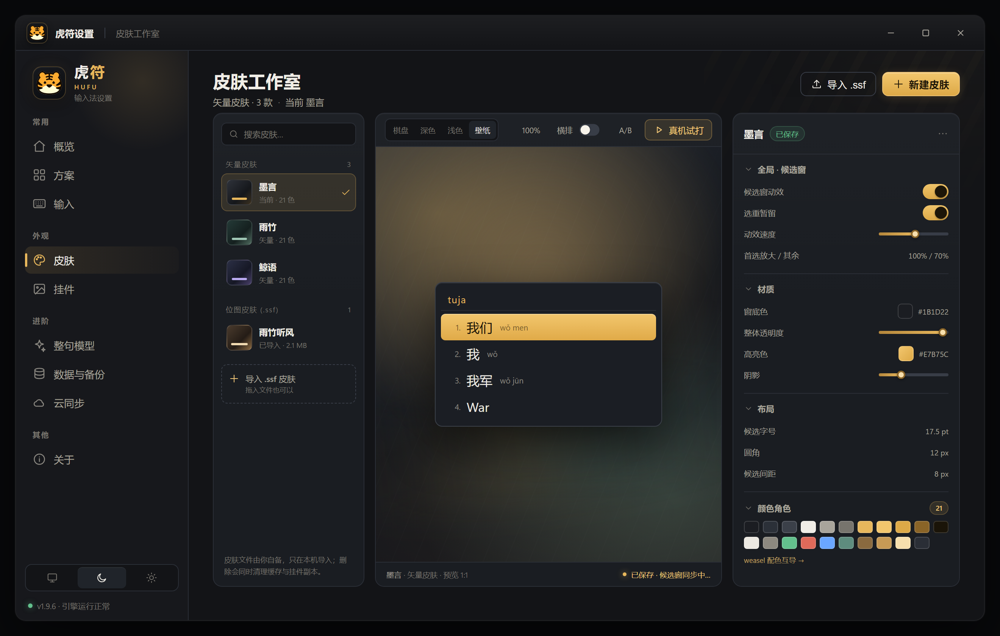

<p align="center">
  
</p>

<h1 align="center">虎符 HuFu</h1>

<p align="center"><strong>以虎码为核心的跨平台中文输入法</strong></p>

<p align="center">
  <a href="https://github.com/LeafHW/hufu-ime-rust/releases/latest"></a>
  
  
  
</p>

> **macOS 版正在开发中（预计 11 月 20 日前后上线）。** IMK 前端骨架已落地（[`platform/macos`](platform/macos/README.md)），尚未发布安装包；Windows 版可直接安装使用。

虎符（HuFu）是一款以 **虎码** 为主码的跨平台中文输入法，名字取自古代调兵信物「虎符」。目标是在 **虎爪输入法（TigerClaw）** 与 **Rime（虎码配置）** 的基础上，做成「统一 Rust 引擎 + 多平台前端 + 图形化设置」的产品级输入法。

## 平台状态

| 平台 | 状态 | 说明 |
| :--- | :--- | :--- |
| Windows 10/11 | ✅ 稳定 | TSF 前端；exe 安装包，已在实机验证 |
| Linux（fcitx5） | ✅ 可用 | 由社区协作者维护；安装见 [`platform/linux`](platform/linux/README.md) |
| macOS | 🚧 开发中 | IMK 骨架已落地，待 Mac 实机迭代；预计 11 月 20 日前后上线，暂无安装包 |

## 界面预览

<p align="center">
  
  
</p>

<p align="center"><sub>设置页 · 概览（浅色）与皮肤工作室（深色）</sub></p>

## 主要功能

- **统一引擎**：Rust 引擎 + TSF / fcitx5 / IMK 前端，共用同一套协议、码表与用户数据
- **虎码整句**：整句输入为核心，ngram 组句 + Qwen3 神经重排，全部权重可调
- **多码表格式**：HuFu 原生 / Rime / 多多 / QQ五笔 / 虎整句，放入方案目录自动识别
- **方案管理**：方案即目录，一键切换，每方案独立用户词
- **候选交互**：多种选重键、翻页、竖排/横排、调序/置顶/软删、滚轮缩放、拖动移位、Shift 标点形态
- **符号系统**：快符、分类符号、动态变量（日期/时间）、`\calc` 计算器、`\w` 自动造词
- **繁简与注解**：OpenCC 简繁 + emoji 候选变体，拼音/拆分/Unicode 注释，双拼反查
- **皮肤**：JSON 皮肤 + .ssf皮肤支持（搜狗主流格式），兼容导入 weasel/squirrel 配色
- **数据自主**：用户词、配置与调整日志本地保存，支持全量快照导出/导入
- **云同步**：WebDAV（坚果云等）双向同步，可按方案勾选同步内容；支持口令加密与回收站恢复
- **按键音效**：4 类按键音，音量可调

功能明细详见 [docs/features.md](docs/features.md)。

## 快速开始

### Windows 10/11

1. 打开 [Releases](https://github.com/LeafHW/hufu-ime-rust/releases/latest)，下载 `HuFuSetup-<version>.exe`（约 25 MB）。
2. 双击安装。旧版会自动原地升级，码表、设置与学习记录全部保留。
3. 新开一个应用，按 `Win+空格` 切到「虎符」；`Ctrl+Alt+H` 打开设置。

- **绿色版**：下载 `HuFu-v<version>-no-model.zip`（约 29 MB），解压后运行 `安装.bat`。
- **整句模型**（约 500 MB）在[「模型文件」发布页](https://github.com/LeafHW/hufu-ime-rust/releases/tag/%E6%A8%A1%E5%9E%8B)单独下载；解压后把「模型」文件夹放到安装目录，约 2 秒自动装载，无需重启。

### Linux（fcitx5）

```sh
platform/linux/install.sh -umt  # 用户级 一键全量安装
fcitx5 -r -d       # 重启 fcitx5（或以发行版的方式）
fcitx5-configtool  # 手动添加「虎符」（或以发行版的方式）
```

- 默认数据 **随仓库自带**（`assets/`）
- 模型与主题不随 `-s/-u` 安装，分别用 `-m`、`-t` 显式独立安装
- 设置页在应用菜单「虎符设置」或 `http://127.0.0.1:4390/`

Linux 详见 [platform/linux/README.md](platform/linux/README.md)

### macOS

macOS 版正在开发中（预计 11 月 20 日前后上线），暂无安装包。IMK 前端骨架、构建方式与当前限制见
[platform/macos/README.md](platform/macos/README.md)；欢迎 Mac 开发者参与。

从源码构建、Windows 系统注册与注意事项详见 [docs/build.md](docs/build.md)；
当前进度与测试基准详见 [docs/status.md](docs/status.md)。

## 文档索引

| 文档 | 内容 |
| --- | --- |
| [features.md](docs/features.md) | 功能总览明细 |
| [architecture.md](docs/architecture.md) | 架构设计与数据流 |
| [build.md](docs/build.md) | 源码构建与系统注册 |
| [status.md](docs/status.md) | 当前进度与测试基准 |
| [dictionary-formats.md](docs/dictionary-formats.md) | 码表格式规范（含 TCSKNM02 模型布局） |
| [asset-sources.md](docs/asset-sources.md) | 资源来源、版本与许可 |
| [research/ime-frontends.md](docs/research/ime-frontends.md) | TSF / IMK 前端研究纪要 |
| [benchmark-latency-100.md](docs/benchmark-latency-100.md) · [benchmark-qwen-vs-ngram.md](docs/benchmark-qwen-vs-ngram.md) | 基准报告 |
| [platform/windows/install/README.md](platform/windows/install/README.md) | Windows 安装与系统注册 |
| [platform/macos/README.md](platform/macos/README.md) | macOS IMK 前端（开发中） |
| [platform/linux/README.md](platform/linux/README.md) | Linux 前端：简介 / 功能 / 安装卸载 / 作者声明 |

## 参与贡献

- **Windows / 引擎 / 设置页**：欢迎 issue 与 PR。
- **Linux（fcitx5）**：由社区协作者维护，相关改动请先阅读 [platform/linux/README.md](platform/linux/README.md)。
- **macOS**：正在开发中，IMK 骨架位于 [platform/macos](platform/macos/README.md)，欢迎 Mac 开发者参与。

提交前请尽量说明复现步骤、系统版本与相关日志；涉及发行 / 打包的改动请先看 [docs/build.md](docs/build.md)。

## 版权声明

- 本项目代码以 [GPL-3.0-or-later](LICENSE) 发布（GPL-3.0 或更高版本）
- 随发行包分发的第三方组件保留其原始许可证：Qwen3 模型（Apache-2.0）、
  llama.cpp（MIT）、OpenCC 词典数据（Apache-2.0）
- 随仓库分发的码表与输入法资源来自：虎码官方发布（<https://huma.ysepan.com>）、
  虎爪输入法 TigerClaw（<https://github.com/lvyww/tigerclaw>，GPL-3.0）；
  随本仓库分发并保留原项目声明，逐文件来源详见
  [docs/asset-sources.md](docs/asset-sources.md)

## 致谢

- **虎爪输入法 TigerClaw**：整句模型、音效与交互设计的重要参考
- **Rime / 虎码配置**：码表生态与配置思路的来源之一
- **虎码官方**：码表与输入法资源
- **Linux fcitx5 前端协作者** 与所有 issue / PR 贡献者
