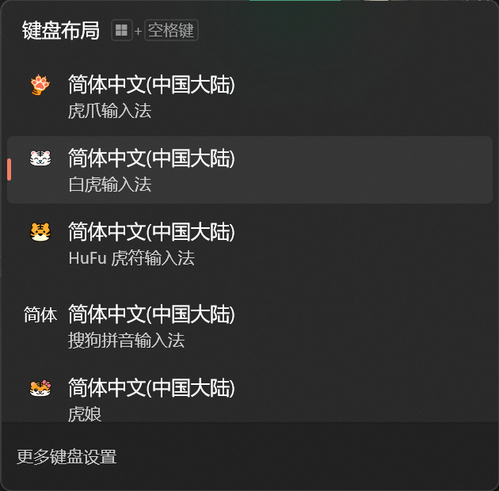

# 1.9.9.13：统一 TSF 虎头图标并实机核对切换器

交付：`C:\Workspace\hufu-ime-rust\交付\HuFuSetup-1.9.9.13.exe`。
39,427,051 字节；SHA256：`2250a0637ccf83bf2be362e0db884f9b0b1167cc44f84819219c19385eadf212`。
本机保持本版本已安装、原生后台运行；未提交、推送或发布。

## 原因与修复

用户截图 `reported-switcher.png` 显示白色斜线标记。它确实来自旧
`platform/windows/hufu-tsf/assets/hufu.ico`，不是图标提取失败。
正确虎头为 `platform/windows/setup/icons/虎符.ico`，SHA256
`0244a889f33fd61c03135b2af5f53eb9381a6cdef26e8a5c583028754a4e68fb`。
前者与后者的 32px 实际图像在 `source-0-32.png`、`source-1-32.png`。

旧 EXE 打包会统一替换 TSF 图标；新增通用流程漏了此步骤，并让新 ARM64
DLL/ARM64X 入口引用了旧 ICO。此前只验证有效 HICON，不能证明品牌图像正确。

- ARM64 MSVC DLL、ARM64X 入口直接从同一虎头 ICO 编译资源；RC 输入统一 UTF-8，
  处理中文文件名。PowerShell 脚本采用 UTF-8 BOM，兼容 Windows PowerShell 5.1。
- GNU x64/x86 的预制资源对象仍为历史内容。通用构建在复制后对普通 DLL 替换图标；
  x64 替换发生在 ARM64X sidecar 哈希/命名之前，不能在链接后改写混合架构入口。
- 新增 `tools/verify_windows_icons.py` 并接入生产构建门禁：按 datafile 读取全部图标组/
  语言和五帧资源，逐字节对照标准 ICO；再以 PrivateExtractIconsW + DrawIconEx
  比对 16/24/32/48/64/256 像素实际绘制结果。不执行被检查 DLL。

## 验证

- 1.9.9.12 作为真实负例：6 份 TSF 均未匹配标准图标，门禁退出 1。
  既有 GNU 资源目录不是 SDK 标准三层结构，资源语言枚举亦报错；更新后结构正常。
- 最终 1.9.9.13：6 份 TSF 的 30 帧资源、36 次 Windows 绘制比对全部通过。
- 最终 ARM64X/native/x86 预检通过；安装后 ARM64、x64、x86 均通过系统 COM 登记
  创建 ITfTextInputProcessorEx，分别加载对应实现。新桥代次 `dbccc2021fbb50e29892`。
- 独立解包：x64 25 文件、ARM64 28 文件、102 个数据资源逐项哈希一致；包结构 9 项通过。
- 真实 1.9.9.12 → 1.9.9.13 覆盖更新退出 0。切换器仍沿用旧图像，随后仅卸载、
  重装本机虎符（均退出 0），菜单改为正确虎头。没有清空系统图标数据库、重启 Explorer
  或修改其他输入法；不将一次覆盖更新等同于所有已运行宿主已刷新图像。
- 最终程序目录 27 个清单文件及 SystemIME 9 个清单文件哈希一致。
  代次为 `1.9.9.13-75d0d4dc570e`。

最终真实切换器截图：

自动化 UIA 未能读取这块切换器的文本树，不将其失败当作图标验证失败或成功。
最终证据来自实际屏幕抓取和人工视觉检查；截图只保留切换器区域。
打开/关闭切换器未选择其他输入法，截图仍选中原来的白虎。

本轮与 1.9.9.12 的载荷差异仅 TSF 图标/桥及其内容代次、版本和架构清单。
维护引擎、后台、评分库、设置程序和资源字节保持，见 `payload-comparison.json`。
没有重复执行未受影响的维护单元测试；也没有宣称完成真实应用键入、跨账户、重启
或原生 x64 系统验证，其他发布前边界见 [待办](../../open-items.md)。

交付目录只保留 1.9.9.13，删除 1.9.9.12 的 EXE/收据和本次重复安装包；原始下载基线
及按契约保留的 SystemIME 代次不作为临时 EXE 清理。详见 `delivery.json`。
